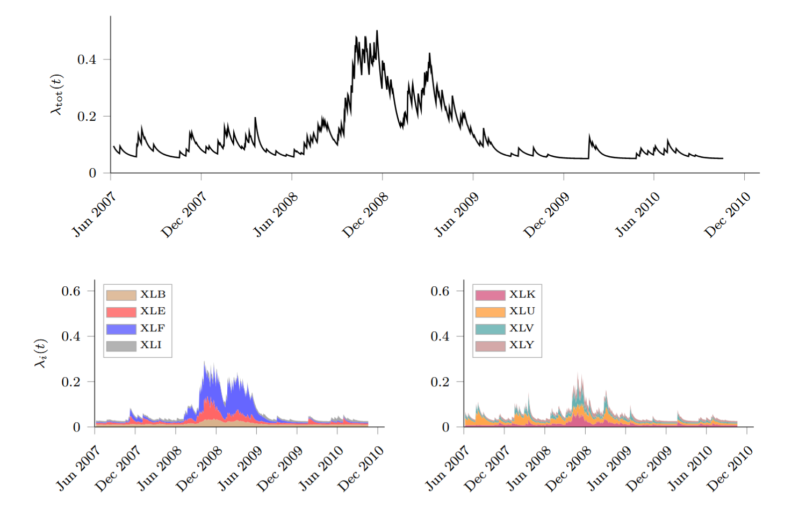
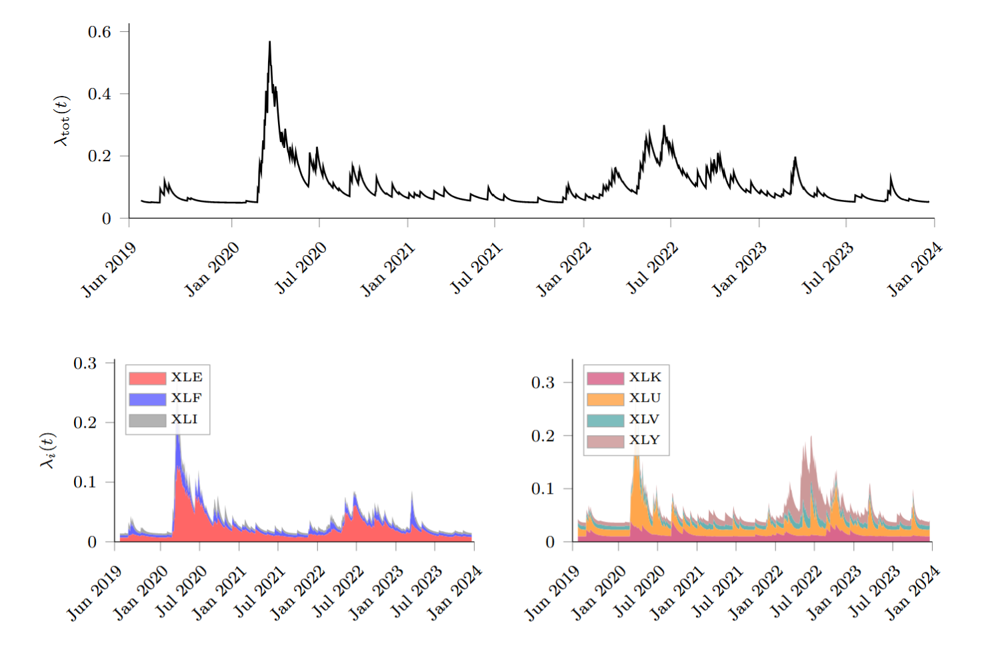

# Financial Contagion as a Self-Exciting Point Process

Code and results of the paper *Financial Contagion as a Self-Exciting Point Process* by Luca Persia (2026), Università della Svizzera italiana.

In this paper, we treat extreme daily losses of the U.S. Select Sector SPDR ETFs (XLB, XLE, XLF, XLI, XLK, XLU, XLV, XLY) as arrivals of a point process. We compare homogeneous and inhomogeneous Poisson benchmarks with univariate and marked multivariate Hawkes processes over two crisis windows, the Global Financial Crisis (June 2007 to January 2011) and COVID 19 (June 2019 to January 2024), and benchmark the Hawkes stress signals against the VIX and a DCC-GARCH(1,1).

## Repository structure
```
src/
  matlab/
    MAIN_CONTAGION.m                    main script, run once per crisis window
    fit_poisson_hom.m                   homogeneous Poisson
    fit_poisson_inhom_loglin.m          inhomogeneous Poisson, log-linear intensity
    fit_hawkes_univariate_exp.m         univariate exponential Hawkes
    fit_hawkes_multivariate_exp_marks.m marked multivariate Hawkes (penalized MLE)
    transform_marks.m                   mark transformation
    hawkes_intensity_at_times_marked.m  multivariate intensities
    hawkes_univ_intensity_at_times.m    univariate intensity
    hawkes_multi_compensator.m          compensator increments for the goodness of fit
  python/
    01_data_extraction.ipynb            CRSP returns (WRDS), stress events and VIX
    02_vix_dcc_benchmark.ipynb          VIX calibration and DCC-GARCH benchmark
results/                              main plots
data/                                 detected events
```

## How to reproduce
By using collected data and detected events:
1. Run `src/matlab/MAIN_CONTAGION.m` with `WINDOW = "GFC"` and then with `WINDOW = "COVID"` (MATLAB with the Optimization and Statistics and Machine Learning toolboxes).
2. Run `src/python/02_vix_dcc_benchmark.ipynb` (`pandas`, `numpy`, `scipy`, `statsmodels`, `arch`).


### Estimated intensities
**Global Financial Crisis**



**COVID-19**



### Main findings
- **Clustering.** Homogeneous Poisson arrivals are rejected in both windows (KS 0.158 for the GFC, 0.117 for COVID 19). The univariate Hawkes model is not rejected in either window, and in the COVID 19 window the multivariate Hawkes gives the best fit (KS 0.077, p = 0.25).
- **GFC.** The spectral radius of the marked contagion matrix is 0.837 (subcritical and highly persistent process). Endogenous amplification is concentrated in financials (XLF self-excitation 0.82), and the aggregate intensity stays elevated for several months around Lehman.
- **COVID 19.** The spectral radius is lower, 0.574. Persistence is centred on energy (0.42) and consumer discretionary (0.56) rather than financials (0.17), and the intensity spike of March 2020 is higher but decays much faster than in the GFC.
- **VIX benchmark.** The multivariate Hawkes signal explains 84.0% (GFC) and 77.6% (COVID 19) of the VIX variance, well above the univariate Hawkes (71.2% and 58.5%) and close to the DCC-GARCH(1,1) (87.4% and 77.9%), using only the timing and severity of tail events.

| R² with VIX (%) | Univariate Hawkes | Multivariate Hawkes | DCC-GARCH(1,1) |
|---|---|---|---|
| GFC | 71.23 | 84.01 | 87.36 |
| COVID-19 | 58.55 | 77.60 | 77.85 |

## Citation
Persia, L. (2026). *Financial Contagion as a Self-Exciting Point Process*. The 2026 International System Dynamics Conference, Delft, Netherlands, Available at SSRN: https://ssrn.com/abstract=7017719 or http://dx.doi.org/10.2139/ssrn.7017719.

## License
Code released under the MIT License, see `LICENSE`.
